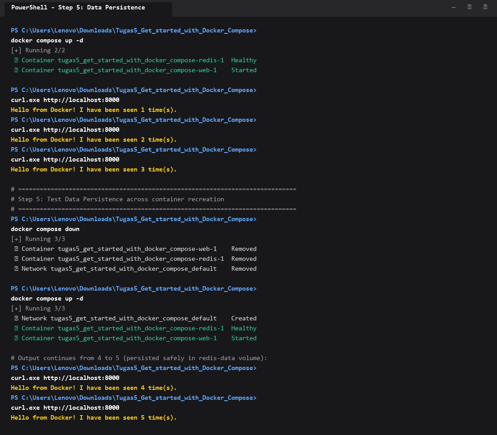
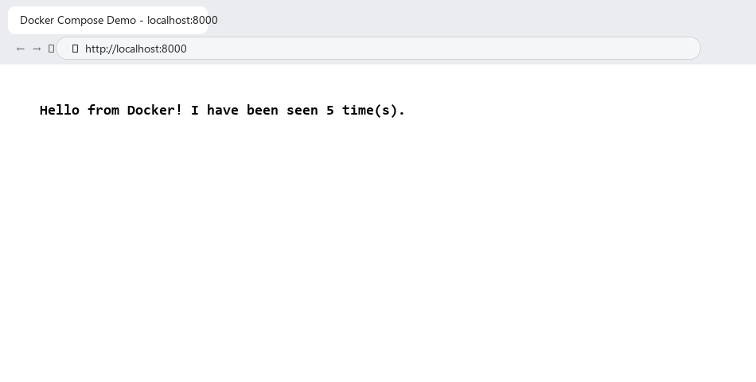
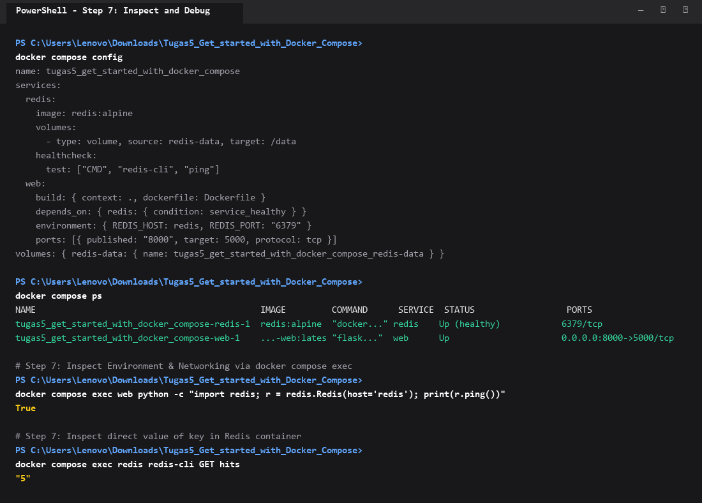

# Docker Compose Quickstart (Tugas 5 - Get Started with Docker Compose)

Repository ini dibuat untuk memenuhi tugas **Tugas 5: Get Started with Docker Compose** berdasarkan panduan resmi [Docker Compose Quickstart](https://docs.docker.com/compose/gettingstarted/).

## Identitas Mahasiswa
- **Nama:** M. Alfin Masykur
- **NIM:** 123103127
- **Repository:** [https://github.com/finnn999/docker-compose-get-started-123103127](https://github.com/finnn999/docker-compose-get-started-123103127)

---

## Ringkasan Langkah-Langkah (Step 1 - Step 7)

### **Step 1: Set up the project**
Mempersiapkan kode aplikasi Flask (`app.py`), dependensi (`requirements.txt`), `Dockerfile`, environment variables (`.env`), dan `.dockerignore`.
- Aplikasi web sederhana menggunakan Flask yang menghitung jumlah kunjungan (hit counter) yang disimpan di cache Redis.
- Port yang digunakan diekspos melalui variabel konfigurasi `APP_PORT=8000`.

### **Step 2: Define and start your services**
Membuat file konfigurasi `compose.yaml` untuk mendefinisikan dua layanan:
- `web`: Dibangun dari `Dockerfile` lokal dan meneruskan port `8000:5000`.
- `redis`: Menggunakan image publik `redis:alpine`.

### **Step 3: Fix the startup race with health checks**
Menambahkan mekanisme `healthcheck` pada service `redis` dan menambahkan `depends_on: redis: condition: service_healthy` pada service `web` agar service `web` hanya berjalan setelah Redis benar-benar siap menerima koneksi.

### **Step 4: Enable Compose Watch for live updates**
Mengonfigurasi blok `develop.watch` pada service `web` sehingga perubahan kode pada host langsung disinkronkan ke dalam container (`sync+restart`), dan perubahan pada `requirements.txt` akan memicu build ulang (`rebuild`).

### **Step 5: Persist data with named volumes**
Menambahkan named volume `redis-data:/data` pada service Redis dan mendaftarkannya pada blok `volumes:` tingkat atas. Hal ini memastikan data hit counter di Redis tetap tersimpan (persist) meskipun container dimatikan (`docker compose down`) dan dijalankan kembali (`docker compose up`).

### **Step 6: Structure your project with multiple Compose files**
Memisahkan konfigurasi infrastruktur Redis ke file `infra.yaml` dan memanggilnya dari file utama `compose.yaml` menggunakan fitur `include`.

### **Step 7: Inspect and debug your running stack**
Melakukan inspeksi konfigurasi dan troubleshooting container menggunakan perintah:
- `docker compose config`: Memeriksa hasil penggabungan file dan resolusi variabel environment.
- `docker compose up -d`: Menjalankan seluruh stack di background.
- `docker compose logs -f`: Memantau live streaming log container.
- `docker compose exec web env`: Memeriksa environment variable di dalam container `web`.
- `docker compose exec web python -c "import redis; ..."`: Menguji konektivitas service discovery dari web ke redis.
- `docker compose exec redis redis-cli GET hits`: Memeriksa langsung nilai hit counter pada database Redis.

---

## Cara Menjalankan

1. **Jalankan aplikasi:**
   ```bash
   docker compose up -d
   ```
2. **Akses aplikasi di browser:**
   Buka [http://localhost:8000](http://localhost:8000)
3. **Melihat log aplikasi:**
   ```bash
   docker compose logs -f
   ```
4. **Hentikan aplikasi:**
   ```bash
   docker compose down
   ```
   *(Gunakan `docker compose down -v` jika ingin menghapus named volume)*


---

## Bukti Eksekusi (Screenshots)

### Screenshot Step 5: Data Persistence with Named Volumes
Menunjukkan proses testing persistensi data Redis:
1. Menjalankan stack dan melakukan hit hingga hit counter mencapai 3.
2. Mematikan stack dengan `docker compose down`.
3. Menjalankan kembali dengan `docker compose up -d`.
4. Mengakses kembali endpoint, di mana counter berlanjut ke angka 4 dan 5 (tidak reset ke 0 karena tersimpan pada volume `redis-data`).




### Screenshot Step 7: Inspect and Debug Running Stack
Menunjukkan hasil perintah inspeksi konfigurasi dan debugging:
- Validasi konfigurasi dengan `docker compose config`.
- Pengecekan status container dengan `docker compose ps`.
- Pengecekan konektivitas dari container web ke redis (`print(r.ping())` -> `True`).
- Pengecekan nilai langsung dari database Redis via `redis-cli GET hits` -> `"5"`.


